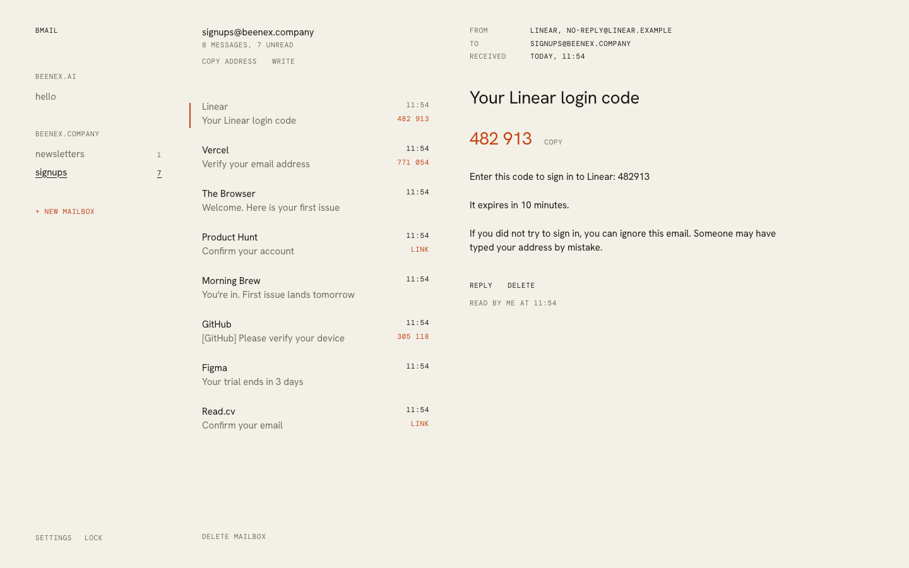

# Simple-Mailbox

bmail: throwaway mailboxes on your own domains, built so an AI agent can use them. Make an address, sign up for something with it, and read the code that arrives. All of it sits behind a 6-digit PIN, so your main inbox never sees any of it.



## Requirements

- **First run:** the app makes your PIN and shows it once. bmail keeps only a hash of it.
- **Resend:** after the first sign-in, the app asks for a Resend API key (Full access) and lists the domains in that Resend account.
- **Sign in:** a 6-digit PIN. After 5 wrong PINs from one IP, sign in locks for 15 minutes. After 50 wrong PINs from all IPs together in 15 minutes, it locks for everyone.
- **More PINs:** make one PIN per agent or device in Settings, each with a name. Each email shows which PIN read it first ("Read by Claude at 10:43"). Removing a PIN signs out everything that used it.
- **Mailboxes:** add and delete mailboxes on any of your domains, with a chosen name or a random one. Each mailbox keeps the email it sends and receives. `name+anything@domain` arrives in `name@domain`.
- **Codes:** bmail finds the verification code or link in each email and shows it first.
- **Stack:** Cloudflare only for hosting and storage (Workers, D1, Email Routing). Resend sends the mail.
- **Domain:** `bmail.beenex.company`.

## How it works

| Piece | What it does |
|---|---|
| Cloudflare Worker (Hono) | The API, and it serves the React app. |
| D1 | PINs (hashed), sessions, mailboxes, emails, the Resend key (encrypted). |
| Cloudflare Email Routing | Each domain's catch-all sends incoming mail to the Worker's `email()` handler. Mail to an address with no mailbox bounces. |
| Resend | Lists your domains and sends outgoing mail. |

Secrets in D1 are protected by `APP_SECRET`, a Worker secret that is never stored in the database. The Resend key is encrypted with AES-256-GCM, and PINs are hashed with HMAC-SHA-256, both under keys derived from `APP_SECRET`. A copy of the database alone reveals neither.

Email HTML is shown in a sandboxed frame with no scripts, and remote images stay blocked until you choose Load images, because they are used to track opens.

## Run it locally

```bash
npm install
cp .dev.vars.example .dev.vars     # then set APP_SECRET: openssl rand -base64 48
npm run db:migrate:local
npm run dev                       # http://localhost:5173
npm test                          # unit tests
```

To try the app without a real Resend account, run a mock Resend server and point `RESEND_API_BASE` at it in `.dev.vars` (see `.dev.vars.example`).

To test incoming mail locally, run the built Worker with `wrangler dev` and post a raw email to it:

```bash
npm run build
npx wrangler dev -c dist/simple_mailbox/wrangler.json --port 8788
curl -X POST "http://127.0.0.1:8788/cdn-cgi/handler/email?from=a@example.com&to=signups@yourdomain.com" --data-binary @email.eml
```

The local email handler needs the `.eml` file to have a `Message-ID` header.

## Deploy

Every push to `main` deploys (`.github/workflows/deploy.yml`): typecheck, tests, find or create the D1 database, build, apply D1 migrations, `wrangler deploy`, set `APP_SECRET` on the Worker, then check that the site answers. If a step fails, nothing after it runs. **Run workflow** under the repo's Actions tab redeploys without a new commit.

The workflow uses three repo secrets:

- `CLOUDFLARE_API_TOKEN` and `CLOUDFLARE_ACCOUNT_ID`: the same Cloudflare token ChimpMail deploys with ("Edit Cloudflare Workers" template plus Account > D1 > Edit).
- `APP_SECRET`: a random value, made once with `openssl rand -base64 48 | gh secret set APP_SECRET`. Never change it.

Receiving mail: for each domain, in the Cloudflare dashboard, go to Email > Email Routing and set **Catch-all address** to **Send to a Worker > simple-mailbox**. The domain's DNS must be on Cloudflare. Enabling Email Routing replaces the domain's MX records, so use a domain or subdomain that doesn't already receive mail somewhere else.

The first visitor to a fresh deploy makes the first PIN, so open it right after the first deploy.

### Lost APP_SECRET

Changing or losing `APP_SECRET` makes every PIN stop working and the Resend key unreadable. To start over without losing mail: set a new `APP_SECRET`, run `npx wrangler d1 execute simple-mailbox-db --remote --command "DELETE FROM sessions; DELETE FROM pins; DELETE FROM settings"`, open the site to make a new PIN, and enter the Resend key again. Mailboxes and email are kept.

## Agent API

Every request takes `Authorization: Bearer <PIN>`. A session token from `POST /api/auth/pin` works too. Settings > Agent access has these instructions ready to copy.

| Call | What it does |
|---|---|
| `GET /api/domains` | Domains you can use. |
| `GET /api/mailboxes` | Mailboxes, with unread counts. |
| `POST /api/mailboxes` `{"domain", "name"?}` | Makes a mailbox. Leave out `name` for a random one. |
| `GET /api/mailboxes/<address>/wait?timeout=60&after=<ms>` | Waits up to 90 s for the next email and returns it with `code` and `link` already found. |
| `GET /api/mailboxes/<address>/messages?after=<ms>` | Emails, newest first. |
| `GET /api/messages/<id>` | The full email. The first open marks it read. |
| `POST /api/mailboxes/<address>/send` `{"to", "subject", "text", "replyTo"?}` | Sends plain text. `replyTo` is a message id. |
| `DELETE /api/mailboxes/<address>` | Deletes the mailbox and its email. |

## Design

The Paper design: off-white paper, ink, one grey, one orange accent. There are three type styles: Hanken Grotesk 28px for what matters, Hanken Grotesk 15px for reading, and DM Mono 11px capitals for labels. There are no boxes. The verification code is the only large orange thing on the screen, so it is what you see first. The three directions considered are in `design/options/`.
